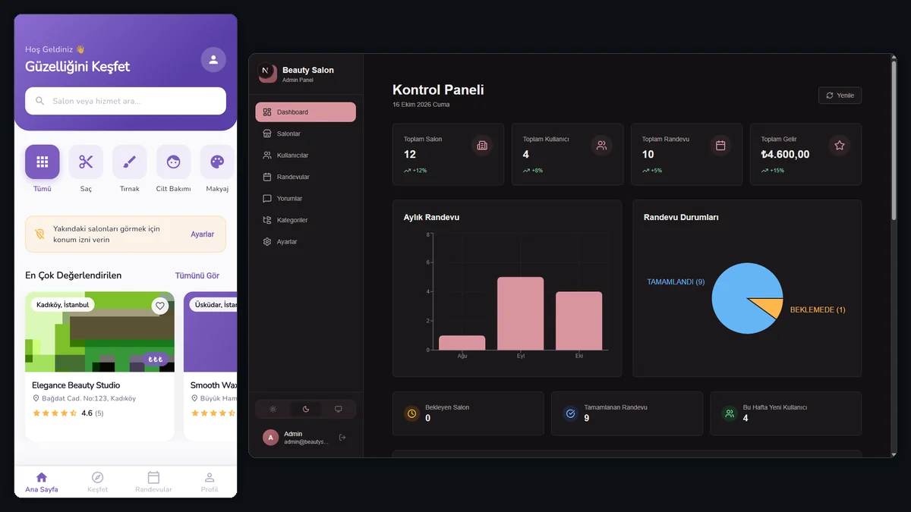

<sub><b>English</b> · <a href="README.md">Türkçe</a></sub>

<div align="center">

# Beauty Salon Platform

**A multi-tenant booking and management platform for beauty salons.**
Customers discover salons and book appointments; salon owners manage their team, services and
appointments; the platform admin oversees every tenant — all through a single backend.

4 applications · 646 tests · role-based authorization

[](https://nodejs.org)
[](https://expressjs.com)
[](https://sequelize.org)
[](https://nextjs.org)
[](https://flutter.dev)
[](https://sqlite.org)

</div>

<p align="center"></p>

---

## What it solves

A salon's day-to-day work has to run from one place: a customer must be able to get the right service
from the right staff member, the salon must be able to see its capacity, and the platform must be able
to oversee tenants without mixing them up. This repo contains that entire chain.

| Role | Capabilities |
|---|---|
| **Customer** | Salon discovery, booking by picking a service and a staff member, appointment history, reviews, favorites |
| **Salon owner** | Staff and service management, staff–service mapping, appointment confirm/cancel, dashboard and revenue statistics, salon profile and media |
| **Platform admin** | Tenant (salon) and user management, categories, review moderation, platform settings |

## Applications

This is a monorepo; four applications share the same API contract.

| Application | Tech | What it does |
|---|---|---|
| [`apps/api`](apps/api) | Node.js · Express 5 · Sequelize 6 · JWT | REST API, business rules, authorization, file upload, notifications |
| [`apps/admin_panel`](apps/admin_panel) | Next.js 16 · TypeScript · Tailwind 4 · recharts | Platform admin panel (salons, users, appointments, reviews, categories, settings) |
| [`apps/customer_app`](apps/customer_app) | Flutter · Riverpod 3 · go_router · Dio | Customer mobile app |
| [`apps/salon_app`](apps/salon_app) | Flutter · Riverpod 3 · go_router · Dio | Salon owner mobile app (appointments, team, services, dashboard) |

## Architecture

```
Flutter customer_app ─┐
Flutter salon_app ────┼──►  Express API  ──►  Sequelize  ──►  SQLite (default)
Next.js admin_panel ──┘        │                              PostgreSQL (configurable)
                               ├── JWT access (15 min) + refresh (7 days), bcrypt
                               ├── request body validation with express-validator
                               ├── image upload with Multer (JPEG/PNG/WebP/GIF, max 5 MB, to disk)
                               ├── rate limit · Helmet · CORS allowlist
                               └── Nodemailer (SMTP) · Twilio (SMS, falls back to the console without credentials)
```

**The isolation boundary is the tenant (salon).** Authorization is role-based; a salon owner can only
see their own salon's data, and admin endpoints are closed to the customer and salon roles. This rule
is tested (`tests/user.test.js` → *Session isolation*, *Role-based access*).

The data model has 12 tables: `User`, `Salon`, `Staff`, `StaffService`, `Service`, `ServiceCategory`,
`Appointment`, `Review`, `Favorite`, `Notification`, `Product`, `Setting`.
`StaffService` is also the join table that carries the staff–service relationship.

## Quick start

```bash
# 1) API
cd apps/api
npm install
cp .env.example .env          # fill in JWT_SECRET / JWT_REFRESH_SECRET (min. 32 chars)
npm run seed                  # demo data (idempotent)
npm run dev                   # http://localhost:3000/api/v1

# 2) Admin panel
cd apps/admin_panel
npm install
cp .env.example .env.local    # NEXT_PUBLIC_API_URL=http://localhost:3000/api/v1
npm run dev -- -p 3001         # API occupies 3000, so the panel runs on another port

# 3) Flutter apps
cd apps/customer_app          # or apps/salon_app
flutter pub get
flutter run --dart-define=API_BASE_URL=http://localhost:3000/api/v1
```

In the mobile apps the address is overridden at build time: `API_BASE_URL`, `MEDIA_BASE_URL`,
`WS_BASE_URL` (`lib/app/environment.dart`). If they are omitted, the local development default is used.

`npm run seed` is idempotent; it can be run more than once. To fill the database with demo data from
scratch, use `npm run seed:reset`. In production the demo account passwords must come from environment
variables (`SEED_ADMIN_PASSWORD`, `SEED_SALON_PASSWORD`, `SEED_CUSTOMER_PASSWORD`) — if they are
missing, the seed **refuses to run**, so a live installation never ends up with an admin password
everyone knows.

## Tests

The numbers were obtained by running the suites in this repo on 2026-10-23, not copied from documentation:

| Application | Command | Result |
|---|---|---|
| API | `npm test` (Mocha) | **291 tests passing** |
| customer_app | `flutter test` | **271 tests passing** |
| salon_app | `flutter test` | **84 tests passing** |
| admin_panel | — | no tests (see below) |

Total measured on 2026-10-23: 646 tests (API 291 · customer_app 271 · salon_app 84; admin_panel excluded).

The tests cover session isolation, role-based access, appointment status transitions, media path
resolution and body-validation edge cases. For example, there is a test for `DashboardNotifier` —
*"makes a single request for appointments (no N+1 per day)"* — so the dashboard statistics do not fire
one request per day.

## Security notes

- `.env`, `*.sqlite`, `uploads/` are **not tracked**; the repo only carries `.env.example` placeholders.
- In production (`NODE_ENV=production`) seeding with the default demo passwords is refused.
- JWT: short-lived access token + refresh token; passwords are stored with bcrypt.
- Uploads: type and size validation (JPEG/PNG/WebP/GIF, 5 MB default); a bad upload returns 400 instead
  of 500. Images are written to disk as-is; there is no resize/convert step.
- The CORS origin list comes from an environment variable; the default allows local development only.
- The admin panel login form opens **empty** in a production build; demo prefill is enabled only in
  development (Next.js `NODE_ENV` gate, stripped as dead code in production).

## Known limitations

I am not hiding these; this is what the repo actually looks like today:

- **Migrations exist, but the runtime does not run them.** `.sequelizerc` points at
  `src/config/sequelize-config.js` (dialect **postgres**) and `src/database/migrations/` holds 12 migration
  files; the `npm run migrate`, `migrate:status` and `migrate:undo` scripts are defined. Startup still does
  not run migrations: the schema is kept in line by `sequelize.sync()` + `ensureColumns()`, and the SQLite
  database has no `SequelizeMeta` table (`src/test-database.sqlite` checked) — the migrations have never
  been applied and do not match the model definitions exactly. Reversible schema changes require moving the
  runtime to migrations
  (details: [docs/api/09-seed-and-migrations.md](docs/api/09-seed-and-migrations.md)).
- **`admin_panel` is untested.** This is where most of the screens are; top-priority debt.
- **The Swagger packages are not wired up.** `swagger-jsdoc` and `swagger-ui-express` exist as
  dependencies but are not mounted anywhere under `src/`. Today's API documentation is the Markdown
  files under `docs/api/` — either wire up Swagger or drop the dependencies.
- **Uploads are written to local disk.** Horizontal scaling or multi-instance deployment requires
  moving them to shared object storage.
- **The `sharp` dependency is unused.** Files are written to disk as-is by Multer; there is no resizing
  or format conversion. `sharp` is listed in `package.json` but never required under `src/` — either add
  image processing or drop the dependency.
- **No payments or subscriptions.** Platform administration exists, billing does not.
- **SMS/e-mail providers are external services.** Without credentials, SMS is logged to the console
  (development).

## Directory structure

```
apps/
  api/            # Express API · 13 models · 14 routes · 14 test files
  admin_panel/    # Next.js 16 admin panel
  customer_app/   # Flutter customer app
  salon_app/      # Flutter salon app
docs/             # ARCHITECTURE, BACKEND-API, ADMIN-PANEL, CUSTOMER-APP, SALON-APP
plans/            # feature plans and decision records
screenshots/      # application screenshots (E2E verification output)
```

## Documentation

- [Architecture and technology stack](docs/ARCHITECTURE.md)
- [API contract](docs/BACKEND-API.md) · [endpoint list](docs/api/05-endpoints.md) · [quick start](docs/api/12-quickstart.md)
- [Admin panel](docs/ADMIN-PANEL.md) · [customer app](docs/CUSTOMER-APP.md) · [salon app](docs/SALON-APP.md)
- [Missing features and known gaps](docs/MISSING_FEATURES.md)

---

<sub>**Türkçe** — Güzellik salonları için çok kiracılı rezervasyon ve işletme platformu: Express 5 +
Sequelize REST API, Next.js yönetim paneli ve iki Flutter uygulaması (müşteri ve salon sahibi); rol
bazlı yetkilendirme ve kiracı izolasyonu. Üç uygulamanın test sayıları da bu repoda çalıştırılarak
alındı. Tam mimari için [docs/ARCHITECTURE.md](docs/ARCHITECTURE.md). Türkçe sürüm:
[README.md](README.md).</sub>
